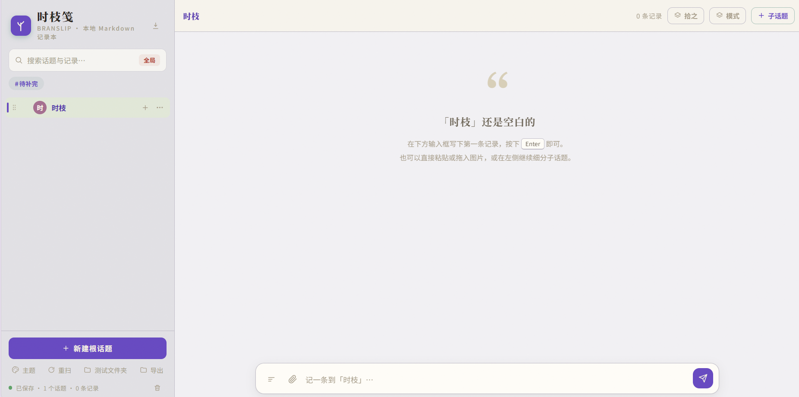
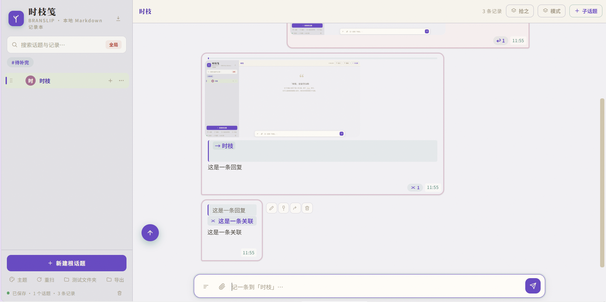

# 时枝笺 · BRANSLIP
> 一个在浏览器运行的本地 Markdown 记录本 · v9.4.5。
> 多级话题、时间戳、聊天式气泡；数据以纯文本存在你选的文件夹里。
>它是：一个聊天式的、本地优先的、纯文本存储的记录本。
>它不是：知识库、云同步工具、多用户协作工具、编辑器。
---
## 为什么不用现有的工具

- **不用 Telegram**：它没有层级，数据在服务器上，翻不动。
- **不用 Obsidian**：它是知识库，为"管理知识"设计；时枝笺为"记录时间里的自己"设计。
- **不用 Trilium**：同上，它是知识树；时枝笺是时间流。
- **不用手机备忘录**：时间戳是元数据，不是身份；数据是孤岛，不是文件夹。

## 它想解决什么

在纸上随手能写时间戳，换到常见笔记软件，写时间戳非常麻烦：
有的会改动笔记时间，有的阅读和编辑要切换模式，摩擦比聊天软件大得多。
聊天软件最接近"随手记"的感觉——但聊天软件没有层级，也没有回顾。

时枝笺想做**随手记，随时记，可回顾，可归类**。
它的直接起点是作者想要一个**多层级的 Telegram**。


- 借用系统文件夹表达**层级**——话题可以无限嵌套
- 用时间戳表达**来处**——每条记录知道自己是什么时候出现的
- 用气泡表达**分叉**——复制、改写、重发，让一个想法演进出多个版本
- 用引用表达**关联**——一条记录可以精确指向另一条
- 数据是纯 Markdown——**这个软件明天消失了，你的文字还在**

---
## 截图预览



## 特性

### 记录与话题
- 多级话题树，文件夹即话题，嵌套不限深度
- 聊天式气泡，右侧发出、左侧回复（对谈模式）
- 每条记录带秒级时间戳，可编辑、可删除、可置顶
- 一次性选中连续多段消息 → 折叠成一条

### 存储
- 数据存本地文件夹，使用 File System Access API，**无上传、无同步、无需联网**
- 按月份切分：`_记录-2026-09.md`、`_记录-2026-10.md`……
- 元数据独立成文件：`_顺序.json`、`_置顶.json`、`_折叠.json`、`_话题.json`、`_主题.json`
- 附件（图片）存 `attachments/`，粘贴/拖入自动压缩
- 写入走队列串行，写入（`.tmp` → 换名），崩溃可恢复
- **跨时区稳定**：每条记录的 blockId 一旦写盘就冻结，换电脑也读得回来

### 检索与浏览
- 话题级 / 全局两级搜索
- 日期跳转（右侧浮动日期 chip）
- 时间流视图（合并多个话题，按时间排序）
- 拾之（随机抽 3 条旧记录看看）
- 时之箭，按照时间顺序概览记录
- 时之间，可设定时间区间及时间点
-  （时之间和时之箭还处于最小可行实现状态）
- 引用语法 `[[~话题ID#^块ID]]`，跨话题精确跳转

### Markdown
- 标准语法交给 `marked`
- 公式交给 `KaTeX`（`$inline$`、`$$display$$`、`\(...\)`、`\[...\]`）
- 自定义语法：
  - `#标签`（可用于快速搜索）
  - `:::think\n…\n:::` 折叠思考块
  - `[[~tid#^bid]]` 内部引用
- 代码块 / 引用块 / 表格 / 标题 全套渲染

### 主题
- 主色 / 气泡色 / 描边色 独立 HSL 可调
- 背景图片 + 蒙版强度
- 全部存 `_主题.json`，重扫后保持

### 导入导出
- 导入对话记录（自动识别格式）：
  - **DeepSeek** `conversations.json`
  - **Claude** `conversations.json`
  - **Qwen** `chat.json`
  - **Telegram** `result.json`
  - 保留原时间戳、时区；对话分支自动变为子话题
- 导出整个文件夹为 ZIP

### 安全
- 消息级回收站（根目录 `_回收站.json`，上限 200 条）
- 话题级回收站（根目录 `_trash/`，可恢复）
- 权限恢复提示：浏览器收回权限时主动询问，不丢内存里的改动

---

## 数据长什么样

选一个文件夹作为"根目录"，结构大致是：

```
根目录/
├─ 工作/
│  ├─ _记录-2026-09.md      ← 这个月的记录（Markdown）
│  ├─ _话题.json             ← 话题 ID（创建时间戳）
│  ├─ _顺序.json             ← 子话题排序
│  ├─ _置顶.json
│  ├─ _折叠.json
│  ├─ attachments/           ← 图片
│  └─ 产品改版/
│     └─ …
├─ 生活/
│  └─ _记录-2026-09.md
├─ _回收站.json              ← 已删消息
├─ _trash/                   ← 已删话题
└─ _主题.json
```

`_记录-2026-09.md` 里的内容就是普通 Markdown：

```markdown
# 工作 · 2026-09

## 2026-09-17 09:00:00.000+08:00

今天想到了一个点子。

## 2026-09-18 10:30:00.000+08:00（已编辑 2026-09-18 11:00:00.000+08:00）

> 今天想到了一个点子。
> [[~2026-09-17_09-00-00-000#^2026-09-17_09-00-00-000]]

展开一下：
```

**任何一个文本编辑器都能打开。** 不依赖这个应用。

---

## 快速开始

### 本地

可以启动一个本地服务器：

```bash
# 任选一种
python -m http.server 8000
npx serve -p 8000
```

或者用 VS Code 的 **Live Server** 扩展，右键在浏览器中打开。

然后浏览器访问 `http://localhost:8000/`，点"选择存储文件夹"选一个空文件夹开始。

### 在线

可部署到 **Cloudflare Workers / Pages**（免费、静态、无服务端）：

1. 把这个仓库 fork 到自己的 GitHub
2. Cloudflare Dashboard → Workers & Pages → 创建Page → 连接到 Git
3. 选仓库，构建命令和输出目录都留空
4. 部署完成，得到一个 `xxx.pages.dev` 的链接

**注意**：
仓库描述中的链接是作者部署的Github Pages，和此仓库同步。
本应用不收集任何数据、不上传任何内容、不连接任何服务器

除首次加载页面所需的静态资源外，它不发起任何网络请求。字体缺失时会降级到系统字体，不影响使用。

你选定的文件夹之外，它不读写任何位置

在线部署版（Github Pages）只是入口，你的数据始终在本机

bug无法完全排除，请尽量备份记录文件。


### 浏览器要求

- **Chrome / Edge 桌面版**（必需，File System Access API）
- **Android Chrome 132+** 可用（体验一般）
- **Safari / Firefox 目前不支持**——它们没有 `showDirectoryPicker`

---

## 开发

### 架构

```
storage.js      File System Access API 唯一封装层
    ↑
io.js           文件级读写
format.js       时间戳格式化 + 解析（纯函数）
md.js           Markdown 渲染 + 解析
    ↑
loader.js       磁盘 → 内存树（扫描）
writer.js       写队列（唯一磁盘写入口）
mutate.js       内存变更（纯函数）
    ↑
store.js        运行时状态
    ↑
tree.js / entries.js / trash.js / composer.js / pages.js / …
    ↑
app.js          启动 + 编排 + 依赖注入
```

**依赖方向自上往下，反向依赖用 `wireXxx` 注入**——避免 ES module 循环引用。


### 测试

```bash
npm test
```

纯函数层覆盖较全，集中在纯函数层与跨模块不变量；UI 层靠手动回归。

### 依赖

- **`marked`** — Markdown 渲染
- **`KaTeX`** — 数学公式

两者都本地 vendor（`vendor/`），**不依赖 npm 安装**，不依赖构建工具。

---


---

## 关于未来的开发和维护计划
**现在是最小可行版本、计划完善的：**
- 移动端体验（拖拽、触屏交互）
- 时之间（区间 + 时间点的编辑交互）
- 导入器的错误提示（哪种格式坏、坏在哪）
**不确定会不会做的：**
- 桌面端（Tauri 打包）
- 其他则不确定，作者不是专业程序员，也无法预期是否会一直开发新功能。

## 反馈

欢迎提 Issue，但请描述**具体的场景**——比如"我在什么情况下，点了哪个按钮，期望发生什么，实际发生了什么"。
但不保证及时回复和修复问题。

---

## 已知限制

- **不支持云同步**——多设备请用 Syncthing 之类的文件夹同步工具
- **不支持多用户**——单用户本地应用
- **Safari / Firefox 不可用**——浏览器 API 限制，未来如果制作Tauri 版本，这一点会改变
- **超大文件夹的 ZIP 导出会占内存**（整文件读进内存算 CRC32）


---

## License

时枝笺 · BRANSLIP


Copyright (C) 2026 Okine (https://github.com/Okine)

This program is free software: you can redistribute it and/or modify it
under the terms of the GNU Affero General Public License as published by
the Free Software Foundation, either version 3 of the License, or (at
your option) any later version.

This program is distributed in the hope that it will be useful, but
WITHOUT ANY WARRANTY; without even the implied warranty of
MERCHANTABILITY or FITNESS FOR A PARTICULAR PURPOSE.  See the GNU
Affero General Public License for more details.

You should have received a copy of the GNU Affero General Public License
along with this program.  If not, see <https://www.gnu.org/licenses/>.

---

## 鸣谢

这个项目的绝大部分代码由 LLM 生成，
理念判断、功能取舍、bug 发现与回归由作者完成。
项目整体的著作权归 Okine 所有。
本项目以 AGPL-3.0-or-later 授权。见 LICENSE。使用、修改、再分发时请遵守该许可证。
"时枝笺"、"BRANSLIP" 为本项目的名字。
fork 或修改后重新发布时，请另取名字，避免混淆。
（这不影响按 AGPL-3.0 使用、修改、分发的权利——只是请求在衍生作品上不要复用这个名称。）


